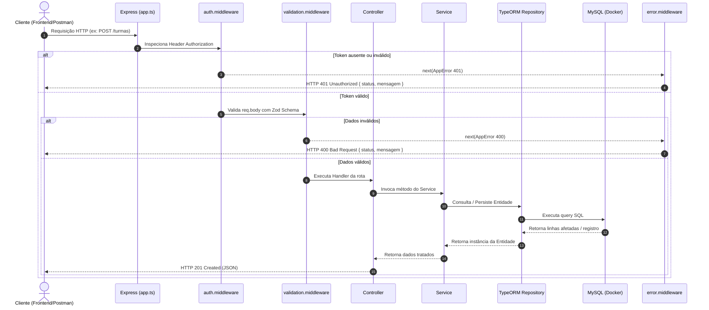

# Documentação de Arquitetura e Engenharia de Software — TIA Backend

> **Projeto:** TIA (Teaching Intelligent Assistant)  
> **Contexto:** Projeto Integrador IV (PI 4) — Ciência da Computação / Sistemas de Informação (UNICAP)  
> **Versão:** 1.0.0  
> **Stack:** Node.js, TypeScript, Express, TypeORM, MySQL, Docker, Zod, JWT, Bcrypt  

---

## 📑 Sumário

1. [Visão Geral do Sistema](#1-visão-geral-do-sistema)
   - [Propósito do TIA](#11-propósito-do-tia)
   - [Objetivo do Backend](#12-objetivo-do-backend)
2. [Visão Arquitetural](#2-visão-arquitetural)
   - [Estilo Arquitetural: Monólito Modular em Camadas](#21-estilo-arquitetural-monólito-modular-em-camadas)
   - [Separação de Responsabilidades (SoC)](#22-separação-de-responsabilidades-soc)
   - [Diagrama da Arquitetura](#23-diagrama-da-arquitetura)
3. [Estrutura de Pastas e Organização do Código](#3-estrutura-de-pastas-e-organização-do-código)
   - [Árvore Completa do Projeto](#31-árvore-completa-do-projeto)
   - [Detalhamento de Diretórios e Papéis](#32-detalhamento-de-diretórios-e-papéis)
   - [Convenções de Nomenclatura](#33-convenções-de-nomenclatura)
4. [Padrões de Projeto (Design Patterns) Aplicados](#4-padrões-de-projeto-design-patterns-aplicados)
   - [4.1 Repository Pattern](#41-repository-pattern)
   - [4.2 Data Mapper (ORM Pattern)](#42-data-mapper-orm-pattern)
   - [4.3 Template Method / Generic Inheritance Pattern](#43-template-method--generic-inheritance-pattern)
   - [4.4 Factory Pattern (Router Factory)](#44-factory-pattern-router-factory)
   - [4.5 Chain of Responsibility (Middleware Pattern)](#45-chain-of-responsibility-middleware-pattern)
   - [4.6 Adapter / Wrapper Pattern](#46-adapter--wrapper-pattern)
   - [4.7 Data Transfer Object (DTO) com Validação em Tempo de Execução](#47-data-transfer-object-dto-com-validação-em-tempo-de-execução)
   - [4.8 Singleton Pattern](#48-singleton-pattern)
   - [4.9 Centralized Error Handling / Custom Exception](#49-centralized-error-handling--custom-exception)
   - [4.10 Declaration Merging (TypeScript Extensibility)](#410-declaration-merging-typescript-extensibility)
5. [Ciclo de Vida da Requisição (Request Lifecycle)](#5-ciclo-de-vida-da-requisição-request-lifecycle)
   - [Fluxo de Sucesso](#51-fluxo-de-sucesso)
   - [Fluxo de Erro e Exceções](#52-fluxo-de-erro-e-exceções)
   - [Diagrama de Sequência](#53-diagrama-de-sequência)
6. [Mecanismos Transversais](#6-mecanismos-transversais)
   - [Autenticação e Autorização (JWT)](#61-autenticação-e-autorização-jwt)
   - [Criptografia de Senhas (Bcrypt)](#62-criptografia-de-senhas-bcrypt)
   - [Validação com Schemas Zod](#63-validação-com-schemas-zod)
   - [Tratamento Centralizado de Erros](#64-tratamento-centralizado-de-erros)
7. [Camada de Dados e Persistência](#7-camada-de-dados-e-persistência)
   - [Configuração do TypeORM](#71-configuração-do-typeorm)
   - [Auditoria e Herança de Entidades](#72-auditoria-e-herança-de-entidades)
   - [Infraestrutura com Docker Compose](#73-infraestrutura-com-docker-compose)
8. [Guia de Implementação de Novos Módulos](#8-guia-de-implementação-de-novos-módulos)

---

## 1. Visão Geral do Sistema

### 1.1 Propósito do TIA
O **TIA (Teaching Intelligent Assistant)** é uma plataforma voltada para professores de língua inglesa que lecionam para crianças de até 12 anos. O sistema resolve o problema de registros de aula dispersos e sobrecarga cognitiva do docente, provendo uma ferramenta centralizada para:

$$\text{Registrar} \longrightarrow \text{Organizar} \longrightarrow \text{Consultar} \longrightarrow \text{Acompanhar}$$

Entre os dados pedagógicos gerenciados estão: participação, desempenho em atividades, dificuldades pontuais, conquistas pedagógicas, observações de comportamento e histórico longitudinal de evolução das habilidades de linguagem esperadas.

### 1.2 Objetivo do Backend
O backend do TIA atua como o núcleo de regras de negócio, autenticação, autorização e persistência de dados relacionais. Ele fornece uma API RESTful para o cliente web/frontend e foi projetado para permitir extensibilidade futura para integração com serviços de Inteligência Artificial generativa e analítica.

---

## 2. Visão Arquitetural

### 2.1 Estilo Arquitetural: Monólito Modular em Camadas
O sistema adota o estilo arquitetural de **Monólito Modular** com **Separação em Camadas** (adaptada do MVC clássico para APIs REST em Express/Node.js).

O código é particionado verticalmente por **Módulos de Domínio** (`src/modules/*`), enquanto compartilha um núcleo transversal e genérico horizontal (`src/common/*`) e uma camada de infraestrutura de dados (`src/data/*`).

```
                    ┌────────────────────────┐
                    │    Cliente / Frontend  │
                    └───────────┬────────────┘
                                │ HTTP (JSON)
                                ▼
┌─────────────────────────────────────────────────────────────────┐
│                        BACKEND TIA                              │
│                                                                 │
│  [src/server.ts] ── Inicialização & Conexão BD                 │
│         │                                                       │
│         ▼                                                       │
│  [src/app.ts] ──── Configuração Express & Roteador Global       │
│         │                                                       │
│         ├─► Middlewares Globais (express.json, errorHandling)   │
│         │                                                       │
│         ▼                                                       │
│  [src/modules/*] ── Módulos de Domínio (ex: Professor)          │
│    ├── Controller / Router (Entrada HTTP, validação DTO)        │
│    ├── Service (Regras de Negócio e Casos de Uso)               │
│    ├── Entity (Mapeamento Objeto-Relacional TypeORM)            │
│    └── Schema (Definição Zod de entrada/saída)                  │
│         │                                                       │
│         ▼                                                       │
│  [src/common/base] ─ Abstrações Genéricas Reutilizáveis         │
│    ├── EntidadeGenerica (id, criadoEm, atualizadoEm)            │
│    ├── ServiceGenerico<T> (CRUD base reaproveitável)            │
│    └── criarRouterGenerico<T> (Factory de Rotas CRUD)           │
│         │                                                       │
│         ▼                                                       │
│  [src/data/data-source.ts] ── TypeORM Data Source               │
└───────────────────────────────┬─────────────────────────────────┘
                                │ Driver mysql2
                                ▼
                  ┌───────────────────────────┐
                  │   Banco MySQL 8.0 (Docker) │
                  └───────────────────────────┘
```

### 2.2 Separação de Responsabilidades (SoC)

A separação é orientada ao princípio da responsabilidade única (SRP):

| Camada / Arquivo | Responsabilidade Principal | O que NÃO deve conter |
|---|---|---|
| **Bootstrap (`server.ts`)** | Inicializar banco de dados, escutar porta TCP e capturar falhas fatais de boot. | Regras de rotas, middlewares ou lógica de negócio. |
| **Aplicação (`app.ts`)** | Configurar o Express, registrar middlewares transversais e acoplar os roteadores dos módulos. | Conexões diretas a banco ou escuta de porta (`listen`). |
| **Controllers (`*.controller.ts`)** | Interceptar requisições HTTP, extrair parâmetros/body/auth, chamar o serviço e retornar status/JSON. | Consultas diretas ao banco via SQL ou regras de validação complexas. |
| **Services (`*.service.ts`)** | Implementar as regras de negócio, hashing de senhas, validações de integridade de domínio e orquestrar repositórios. | Objetos `Request` e `Response` do Express. |
| **Entities (`*.entity.ts`)** | Mapear as tabelas do MySQL, definir tipos de colunas, restrições e relacionamentos usando TypeORM. | Lógica de negócio ou formatação de apresentação. |
| **Schemas (`*.schema.ts`)** | Validar payloads brutos de entrada com Zod e fornecer tipos estáticos derivados (DTOs). | Acesso ao banco de dados. |
| **Base Reutilizável (`src/common/base/`)** | Prover implementações genéricas reutilizáveis para entidades, serviços e rotas simples (DRY). | Regras específicas de um domínio particular. |

---

## 3. Estrutura de Pastas e Organização do Código

### 3.1 Árvore Completa do Projeto

```plaintext
tia-backend/
├── .env                              # Variáveis de ambiente (DB, Port, JWT)
├── docker-compose.yaml               # Orquestração do MySQL 8.0 em container
├── package.json                      # Dependências, scripts e metadados npm
├── tsconfig.json                     # Configurações do compilador TypeScript
├── GUIA_DEV.md                       # Manual prático de desenvolvimento
├── README.md                         # Visão geral e guia de Git do projeto
└── src/
    ├── server.ts                     # Ponto de entrada (Entrypoint)
    ├── app.ts                        # Configuração da classe App Express
    ├── data/
    │   └── data-source.ts            # Conexão TypeORM DataSource com MySQL
    ├── common/                       # Recursos transversais e compartilhados
    │   ├── base/                     # Classes e geradores genéricos (Base Framework)
    │   │   ├── base.entity.ts        # Classe abstrata EntidadeGenerica (id, auditoria)
    │   │   ├── base.service.ts       # Classe abstrata ServiceGenerico<T>
    │   │   └── base.controller.ts    # Factory criarRouterGenerico<T>
    │   ├── middlewares/              # Interceptadores de requisição Express
    │   │   ├── auth.middleware.ts    # Validação do cabeçalho Bearer Token JWT
    │   │   ├── error.middleware.ts   # Manipulador centralizado de erros (HTTP 4xx / 500)
    │   │   └── validation.middleware.ts # Validador genérico de schemas Zod
    │   ├── types/                    # Tipagens e extensões de ambient type
    │   │   └── express.d.ts          # Merge da interface Request com req.usuario
    │   └── utils/                    # Utilitários puros e auxiliares
    │       ├── app-error.ts          # Classe de erro customizada com status HTTP
    │       ├── catch-async.ts        # Wrapper para captura de Promises assíncronas
    │       └── jwt.util.ts           # Assinatura e verificação de JWT
    └── modules/                      # Módulos de domínio funcional
        └── professor/                # Módulo de Autenticação e Perfil de Professor
            ├── professor.entity.ts   # Entidade ORM (tabela 'professor')
            ├── professor.schema.ts   # Schemas de validação Zod e DTOs
            ├── professor.service.ts  # Casos de uso: cadastro, login e consulta
            └── professor.controller.ts # Rotas: /auth/cadastro, /auth/login, /auth/me
```

### 3.2 Detalhamento de Diretórios e Papéis

#### `src/common/base/`
Contém o arcabouço de herança e reaproveitamento que elimina código boilerplate repetitivo em CRUDs:
- **`base.entity.ts`**: Define `EntidadeGenerica`, que expõe `id` (chave primária auto-incrementada), `criadoEm` e `atualizadoEm` (gerenciados automaticamente pelo ORM).
- **`base.service.ts`**: Define `ServiceGenerico<T>`, oferecendo `listarTodos()`, `buscarPorId(id)`, `criar(dados)`, `atualizar(id, dados)` e `remover(id)`.
- **`base.controller.ts`**: Fornece `criarRouterGenerico<T>`, uma Factory de roteadores Express que monta automaticamente as rotas REST padrão (`GET /`, `GET /:id`, `POST /`, `PUT /:id`, `DELETE /:id`).

#### `src/common/middlewares/`
Camada intermediária do Express:
- **`auth.middleware.ts`**: Inspeciona `Authorization: Bearer <token>`, valida a assinatura com `JwtUtil` e popula `req.usuario`.
- **`error.middleware.ts`**: Intercepta exceções lançadas nos controllers/services e formata respostas estruturadas em JSON.
- **`validation.middleware.ts`**: Validador idempotente baseado em Zod que lança `AppError` com código 400 em caso de dados inválidos.

#### `src/common/utils/`
Módulos auxiliares com funções puras e classes de suporte:
- **`app-error.ts`**: Extensão de `Error` contendo `statusCode`, permitindo que regras de negócio sinalizem erros HTTP apropriados (400, 401, 403, 404, etc.).
- **`catch-async.ts`**: High-Order Function que captura erros de funções assíncronas e encaminha para `next(erro)`, tornando desnecessários blocos `try/catch` manuais nos controllers.
- **`jwt.util.ts`**: Encapsula geração e decodificação de tokens JWT via `jsonwebtoken`.

#### `src/common/types/`
Declarações de tipo do TypeScript:
- **`express.d.ts`**: Estende a tipagem global do Express (`Express.Request`) adicionando a propriedade opcional `usuario?: PayloadToken`, permitindo acesso com segurança de tipos em qualquer middleware autenticado.

#### `src/modules/`
Cada pasta dentro de `src/modules/` representa um **Bounded Context** ou módulo funcional:
- Cada módulo possui sua própria entidade (`.entity.ts`), regras de validação (`.schema.ts`), lógica de negócios (`.service.ts`) e rotas HTTP (`.controller.ts`).

---

## 4. Padrões de Projeto (Design Patterns) Aplicados

O projeto implementa diversos padrões de projeto consolidados pela engenharia de software (GoF, GRASP e padrões corporativos):

### 4.1 Repository Pattern
- **Problema resolvido:** Desacoplar a lógica de negócio do mecanismo de persistência direta (SQL cru ou driver de banco).
- **Implementação:** O TypeORM provê instâncias de `Repository<T>` obtidas via `AppDataSource.getRepository(Entidade)`.
- **Onde é aplicado:**
  - `ProfessorService` recebe `Repository<Professor>` via injeção em seu construtor:
  ```typescript
  export class ProfessorService extends ServiceGenerico<Professor> {
    constructor(repositorio: Repository<Professor>) {
      super(repositorio);
    }
    // ...
  }
  ```
- **Vantagem:** Facilita a substituição da base de dados e a criação de mocks/stubs para testes de unidade sem acoplamento a conexões de rede ativas.

### 4.2 Data Mapper (ORM Pattern)
- **Problema resolvido:** Isolar as estruturas do banco de dados relacional das entidades de domínio em memória.
- **Implementação:** As classes de entidade (`Professor`, `Turma`, etc.) utilizam metadados via decorators TypeScript (`@Entity`, `@Column`, `@PrimaryGeneratedColumn`), mantendo os objetos livres de comandos diretos de persistência (diferente do padrão Active Record).
- **Onde é aplicado:** `src/modules/professor/professor.entity.ts` e `src/common/base/base.entity.ts`.

### 4.3 Template Method / Generic Inheritance Pattern
- **Problema resolvido:** Evitar a duplicação de rotinas CRUD e colunas comuns em todas as tabelas do sistema (Violação do princípio DRY).
- **Implementação:**
  - `EntidadeGenerica` define a estrutura fundamental de auditoria e chave primária.
  - `ServiceGenerico<T>` define os algoritmos padrão de busca, listagem, gravação e remoção.
- **Onde é aplicado:**
  - Classes concretas como `ProfessorService` herdam métodos genéricos e acrescentam seus métodos específicos (`cadastrar`, `login`).

### 4.4 Factory Pattern (Router Factory)
- **Problema resolvido:** Reduzir a repetição de rotas HTTP de CRUD básico em entidades que não exigem lógica customizada imediata.
- **Implementação:** A função `criarRouterGenerico<T>(servico: ServiceGenerico<T>): Router` atua como uma fábrica de instâncias de `Router` do Express.
- **Onde é aplicado:** `src/common/base/base.controller.ts`.

### 4.5 Chain of Responsibility (Middleware Pattern)
- **Problema resolvido:** Executar pipelines de interceptação de requisições de forma desacoplada e configurável por rota.
- **Implementação:** O fluxo HTTP transita sequencialmente por elos independentes que podem abortar a requisição ou invocar `next()`:
  $$\text{Parsing (JSON)} \longrightarrow \text{Autenticação (JWT)} \longrightarrow \text{Validação (Zod)} \longrightarrow \text{Handler} \longrightarrow \text{Tratamento de Erros}$$
- **Onde é aplicado:**
  - `autenticar`: verifica o token antes de permitir o acesso.
  - `validarRequisicao(schema)`: valida o payload antes de entregar ao controller.
  - `manipuladorDeErros`: captura qualquer exceção e encerra a cadeia.

### 4.6 Adapter / Wrapper Pattern
- **Problema resolvido:** Adaptar o comportamento assíncrono moderno (Promises/Async-Await) ao mecanismo de tratamento de erros baseado em callbacks do Express 4/5.
- **Implementação:** O utilitário `catchAsync` recebe uma função assíncrona `(req, res, next)` e a envelopa em `Promise.resolve(fn(req, res, next)).catch(next)`, adaptando o modelo de erro para a assinatura padrão do Express.
- **Onde é aplicado:** `src/common/utils/catch-async.ts`.

### 4.7 Data Transfer Object (DTO) com Validação em Tempo de Execução
- **Problema resolvido:** Garantir que dados que entram na API atendam a regras de formato e integridade antes de atingir o domínio de negócio, prevenindo dados inválidos no banco de dados.
- **Implementação:** Schemas Zod combinam **validação em tempo de execução** com **inferência estática de tipos TypeScript**:
  ```typescript
  export const criarProfessorSchema = z.object({
    nome: z.string().min(3),
    email: z.string().email(),
    senha: z.string().min(6),
  });
  export type CriarProfessorDTO = z.infer<typeof criarProfessorSchema>;
  ```
- **Vantagem:** Elimina discrepâncias entre a tipagem estática do TypeScript e o tipo real dos dados recebidos no corpo da requisição HTTP em runtime.

### 4.8 Singleton Pattern
- **Problema resolvido:** Garantir instância única e compartilhada de recursos pesados da aplicação.
- **Implementação:**
  - `src/app.ts`: Instancia e exporta a aplicação compilada (`export default new App().app;`).
  - `src/data/data-source.ts`: Instancia e exporta a conexão única `AppDataSource`.

### 4.9 Centralized Error Handling / Custom Exception
- **Problema resolvido:** Evitar vazamento de stack traces de infraestrutura para os clientes da API e unificar as mensagens de erro.
- **Implementação:** A classe `AppError` estende `Error` com `statusCode`. O middleware `manipuladorDeErros` diferencia erros controlados (`AppError`) de falhas inesperadas (convertidas em HTTP 500 padronizado).
- **Onde é aplicado:** `src/common/utils/app-error.ts` e `src/common/middlewares/error.middleware.ts`.

### 4.10 Declaration Merging (TypeScript Extensibility)
- **Problema resolvido:** Disponibilizar os dados do usuário autenticado no objeto `req` do Express sem recorrer ao tipo inseguro `any`.
- **Implementação:** Por meio de `declare global`, a interface `Express.Request` é estendida com o atributo `usuario?: PayloadToken`.
- **Onde é aplicado:** `src/common/types/express.d.ts`.

---

## 5. Ciclo de Vida da Requisição (Request Lifecycle)

### 5.1 Fluxo de Sucesso
1. **Entrada:** O cliente envia uma requisição HTTP (ex.: `POST /auth/login`).
2. **Parser:** O middleware `express.json()` faz o parsing do corpo da requisição para `req.body`.
3. **Roteamento:** O `app.ts` encaminha a requisição para o roteador correspondente (`/auth` $\rightarrow$ `professorRouter`).
4. **Validação:** O middleware `validarRequisicao(loginProfessorSchema)` valida a conformidade dos dados recebidos com o schema Zod. Se aprovado, repassa para o handler.
5. **Autenticação (se rota privada):** O middleware `autenticar` valida o token Bearer, decodifica o payload e injeta em `req.usuario`.
6. **Controller:** O controller desempacota os dados da requisição e delega a execução ao serviço responsável.
7. **Service:** Executa as validações de domínio (ex: verificar credenciais via `bcrypt.compare`).
8. **Repositório / Banco:** Executa as operações necessárias na base de dados MySQL através do TypeORM.
9. **Resposta:** O controller formata a resposta e envia o status HTTP (200, 201 ou 204) com o JSON correspondente.

### 5.2 Fluxo de Erro e Exceções
- Qualquer exceção disparada (seja um erro de validação Zod, um erro operacional `throw new AppError('Mensagem', 404)` ou uma falha de conexão) é capturada pelo wrapper `catchAsync`.
- O wrapper direciona o erro para `next(erro)`.
- O Express pula os handlers normais e entrega o erro ao `manipuladorDeErros` registrado como último middleware em `app.ts`.
- O cliente recebe uma resposta padronizada:
  ```json
  {
    "status": "erro",
    "mensagem": "Descrição do problema"
  }
  ```

### 5.3 Diagrama de Sequência



---

## 6. Mecanismos Transversais

### 6.1 Autenticação e Autorização (JWT)
O sistema adota autenticação **Stateless** via tokens **JWT (JSON Web Token)**:
- **Geração:** O método `JwtUtil.gerarToken({ sub: id, email })` assina o payload utilizando a chave configurada em `JWT_SECRET` e define a expiração configurada em `JWT_EXPIRATION` (ex.: `1d`).
- **Extração e Validação:** O middleware `autenticar` exige o formato `Authorization: Bearer <token>`. Em caso de sucesso, preenche `req.usuario` com o payload decodificado:
  ```typescript
  export interface PayloadToken {
    sub: number; 
    email: string;
  }
  ```

### 6.2 Criptografia de Senhas (Bcrypt)
As senhas nunca são armazenadas em texto simples:
- Durante o cadastro (`ProfessorService.cadastrar`), é gerado um salt criptográfico de 10 rounds:
  ```typescript
  const salt = await bcrypt.genSalt(10);
  const senhaHash = await bcrypt.hash(dados.senha, salt);
  ```
- Durante o login, a verificação ocorre de forma segura contra timing attacks através de:
  ```typescript
  const senhaValida = await bcrypt.compare(dados.senha, professor.senhaHash);
  ```
- Nas respostas HTTP, o campo sensível `senhaHash` é explicitamente desestruturado e omitido antes de enviar os dados ao cliente:
  ```typescript
  const { senhaHash: _, ...professorSemSenha } = professor;
  return professorSemSenha;
  ```

### 6.3 Validação com Schemas Zod
O middleware `validarRequisicao(schema)` sanitiza os dados de entrada:
- Executa `schema.parse(req.body)`.
- Se campos obrigatórios estiverem ausentes ou os tipos forem incompatíveis, as mensagens de inconsistência são formatadas e lançadas via `AppError(mensagem, 400)`.

### 6.4 Tratamento Centralizado de Erros
Implementado por `manipuladorDeErros` em `src/common/middlewares/error.middleware.ts`:
- Erros do tipo `AppError`: retornam com o código HTTP customizado (ex.: 400, 401, 403, 404).
- Erros não previstos (bugs ou quedas de infraestrutura): são logados com `console.error(err)` no servidor e retornam código HTTP 500 com a mensagem `"Erro interno do servidor"`, protegendo detalhes sensíveis da infraestrutura.

---

## 7. Camada de Dados e Persistência

### 7.1 Configuração do TypeORM
A conexão é inicializada a partir de `src/data/data-source.ts` via `AppDataSource`:
- **Driver:** MySQL (`mysql2`).
- **Sincronização:** `synchronize: true` está ativo no ambiente atual de desenvolvimento, gerando e ajustando tabelas automaticamente a partir das entidades. Em ambiente de produção, este comportamento deve ser substituído por migrações controladas (`migrations`).
- **Registro de Entidades:** Cada nova entidade criada no projeto precisa ser declarada no array `entities: [...]` do `AppDataSource`.

### 7.2 Auditoria e Herança de Entidades
Todas as entidades do domínio herdam da classe abstrata `EntidadeGenerica`:
```typescript
export abstract class EntidadeGenerica {
  @PrimaryGeneratedColumn()
  id!: number;

  @CreateDateColumn({ name: 'criado_em' })
  criadoEm!: Date;

  @UpdateDateColumn({ name: 'atualizado_em' })
  atualizadoEm!: Date;
}
```
Isso assegura que todas as tabelas mantenham rastreabilidade de criação e atualização sem duplicar decorators em cada arquivo.

### 7.3 Infraestrutura com Docker Compose
O banco de dados relacional é isolado em um container Docker, padronizando o ambiente de desenvolvimento:
- **Imagem:** `mysql:8.0`
- **Porta:** Mapeamento `3306:3306`
- **Persistência:** Volume nomeado `mysql_data` montado em `/var/lib/mysql`, garantindo que os dados não sejam perdidos ao reiniciar o container.
- **Variáveis de Ambiente:** Definidas em sincronia com o arquivo local `.env`.

---

## 8. Guia de Implementação de Novos Módulos

Ao implementar uma nova entidade de domínio (por exemplo, `Turma` ou `Aluno`), siga o roteiro arquitetural abaixo para manter o padrão do projeto:

```
Passo 1: Entidade  ──►  Passo 2: Schemas  ──►  Passo 3: Service  ──►  Passo 4: Controller  ──►  Passo 5: Registro
(*.entity.ts)            (*.schema.ts)           (*.service.ts)         (*.controller.ts)         (app.ts & data-source.ts)
```

1. **Definir a Entidade (`src/modules/<modulo>/<modulo>.entity.ts`):**
   - Herdar de `EntidadeGenerica`.
   - Utilizar decorators `@Entity()`, `@Column()` e decorators relacionais (`@ManyToOne`, `@OneToMany`) quando aplicável.
   - Declarar a nova entidade no array `entities` de `src/data/data-source.ts`.

2. **Definir os Schemas Zod (`src/modules/<modulo>/<modulo>.schema.ts`):**
   - Criar schemas para criação e atualização (`criar<Modulo>Schema`).
   - Exportar os tipos inferidos correspondentes (`Criar<Modulo>DTO`).

3. **Implementar a Camada de Serviço (`src/modules/<modulo>/<modulo>.service.ts`):**
   - Herdar de `ServiceGenerico<Entidade>`.
   - Injetar o repositório TypeORM no construtor.
   - Adicionar regras de negócio e validações específicas do módulo.

4. **Configurar as Rotas e Controller (`src/modules/<modulo>/<modulo>.controller.ts`):**
   - Se for um CRUD simples sem regras adicionais: utilizar `criarRouterGenerico(servico)`.
   - Se possuir regras e relacionamentos específicos: criar rotas com `Router()`, encadear `autenticar`, `validarRequisicao(...)` e envolver os métodos com `catchAsync`.

5. **Registrar o Roteador no Express (`src/app.ts`):**
   - Importar o roteador e adicioná-lo dentro do método `configurarRotas()`:
     ```typescript
     this.app.use('/<recurso>', <modulo>Router);
     ```

---

## 9. Referência de Comandos e Scripts

| Comando | Descrição |
|---|---|
| `npm run dev` | Inicia o servidor em modo de desenvolvimento com hot-reload via `tsx`. |
| `docker compose up -d` | Inicia o container do banco de dados MySQL em segundo plano. |
| `docker compose ps` | Exibe o status de execução do container do banco de dados. |
| `docker compose logs -f db` | Exibe os logs contínuos do MySQL para monitoramento e depuração. |
| `docker compose down` | Para e remove o container do banco, preservando o volume de dados. |
| `docker compose down -v` | **Atenção:** Remove o container e exclui definitivamente os dados persistidos no volume. |
